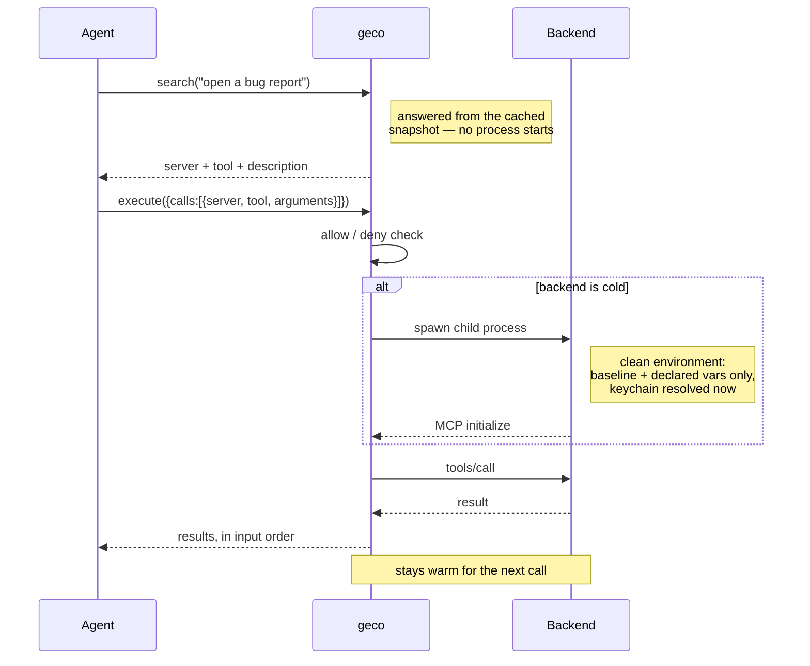

# geco

*the **ge**neric **co**nnector*

## Why it exists

[MCP](https://modelcontextprotocol.io) (Model Context Protocol) is how agents connect to external tools — GitHub, a browser, your filesystem. Each connected server hands the model its full tool catalogue: every tool name, description and JSON input schema, in the system prompt, on every request.

The more MCP tools you expose to your LLM, the more the context gets prefilled with ballast that most likely is not even used, reducing the space you have to work with.
The same is true for skills. Skills are great recipes to have but they also land as descriptive text in the context of your LLM — and again, more skills means less remaining context for the actual task.

So here comes this rusty reptile geco to tackle it. It sits between your IDE and the skills and MCP tools that you have, and gives your LLM the same 8 tools always, no matter how much you have in your tool shed.

**geco is an MCP and SKILL gateway** that keeps your servers' tool schemas **out of the model's context until the moment they're needed**. Put N servers behind it; the agent sees eight small meta-tools instead of every schema on every request.

The cost is fixed: **~4.7 KB of context, whatever is behind the gate** — 10 servers or 100. That number is measured by a test, not asserted, so it can't quietly drift.

Built with Rust as single static binary, no runtime dependencies. macOS, Linux, and Windows. Design inspired by [lazy-mcp](https://github.com/voicetreelab/lazy-mcp) (MIT) — reimplemented from scratch on the official [rmcp](https://crates.io/crates/rmcp) SDK, with search, self-refreshing snapshots, allowlists, and status built in.

## How it works

The agent sees exactly eight meta-tools:

| Meta-tool | Purpose |
|---|---|
| `list_mcp_servers` | Name, description, tool count, running state of each backend |
| `list_tools` | A server's tools (name + description); with `tool`: the full input schema |
| `refresh_tools` | Re-scan backends after installing/reconfiguring one |
| `list_skills` | Every skill in the library (name + one-line description) |
| `read_skill` | Load a skill's SKILL.md + file inventory (runs bundled scripts via your shell) |
| `search` | Find tools AND skills by keywords in one call; `include_schema=true` for inline schemas; `kind="tools"` or `"skills"` to filter |
| `execute` | Run 1–10 tool calls in one round-trip; cross-backend calls run in parallel; results in input order |
| `health` | Report which backends failed their last refresh and why |


Tool catalogues come from a **snapshot** cached on disk. The proxy refreshes it automatically at startup when your config changes (hash-based), or on demand — backends stay cold the rest of the time. A backend process starts only when `execute` first touches it, and is reused afterwards.

A full round trip, cold backend included:



Calls to *different* backends in one `execute` run in parallel; results always come back in the order you sent them.

## Install

Prebuilt binaries are published for macOS (arm64, x86_64), Linux (x86_64 static, aarch64) and Windows (x86_64) — **no Rust toolchain required**. The installers download the right one, verify its SHA-256, and fall back to a source build for any other platform.

### macOS / Linux

```bash
git clone https://github.com/berndsalomon83/geco.git && cd geco
bash install.sh
```

### Windows

```powershell
git clone https://github.com/berndsalomon83/geco.git; cd geco
.\install.ps1
```

Add `--from-source` (`-FromSource` on Windows) to build with cargo instead. See [INSTALL.md](INSTALL.md) for checksums, macOS Gatekeeper, and the private-repo caveat.

### Wire it into your agent

Move the MCP servers you want behind the proxy into `~/.config/geco/config.yaml` (copy-paste from your existing agent config — the `mcpServers` format is identical). Then register the **proxy** instead of the individual servers:

**OpenCode** (`~/.config/opencode/opencode.json`):
```jsonc
{
  "mcp": {
    "geco": { "type": "local", "command": ["geco", "serve"], "enabled": true }
  }
}
```

**Claude Desktop** (`claude_desktop_config.json`):
```json
{
  "mcpServers": {
    "geco": { "command": "/path/to/geco", "args": ["serve"] }
  }
}
```

Remove the individual server entries you moved behind geco — restart the agent and it sees only the 8 meta-tools. See [INSTALL.md](INSTALL.md) for the full guide.

## Quick start

```bash
bash install.sh          # downloads a prebuilt binary, or builds if none matches
```

Create `~/.config/geco/config.yaml` (see `geco.example.yaml`; JSON is equally accepted) — entries are copy-paste compatible with both Claude Desktop and OpenCode shapes:

```jsonc
{
  "mcpServers": {
    "github": {
      "command": "npx",
      "args": ["-y", "@modelcontextprotocol/server-github"],
      "env": { "GITHUB_PERSONAL_ACCESS_TOKEN": "${GITHUB_TOKEN}" },
      "description": "GitHub: issues, PRs, repos",
      "deny": ["delete_*"]
    },
    "filesystem": {
      "command": ["npx", "-y", "@modelcontextprotocol/server-filesystem", "${HOME}/Documents"],
      "description": "Files under ~/Documents"
    }
  }
}
```

## Skills on demand

Agent skills have the same context disease as tools: every skill's name and description ride in the system prompt of every session (measured live: 36 skills ≈ 2,300 tokens, used or not). Point the gateway at a skill library instead:

```yaml
skills:
  dirs: ["~/.config/opencode/skills-library"]
```

Three meta-tools appear: `list_skills` (the whole catalogue), `search` (with `kind="skills"` to find a playbook by intent) and `read_skill` (full SKILL.md + bundled file paths — the agent runs scripts via its shell exactly as a native skill would instruct). Migration: move skills out of the auto-loaded dir into the library; keep your few daily drivers native if you like:

```bash
mkdir -p ~/.config/opencode/skills-library
mv ~/.config/opencode/skills/* ~/.config/opencode/skills-library/
```

Add one line to your global AGENTS.md so models reach for it: *Before specialized work, search (kind="skills") → read_skill and follow the playbook.*

### Which tools' skills work

Any of them. geco has no notion of opencode here — a skill is just a directory
containing a `SKILL.md` with YAML frontmatter, which is the Agent Skills
layout Claude Code, Claude Desktop and opencode all use. Point `dirs` at a
library and `absorb` at whatever directory your agent auto-loads from:

```yaml
skills:
  dirs: ["~/.config/geco/skills-library"]   # served on demand
  absorb:                                    # swept into the library at startup
    - "~/.claude/skills"                     # Claude Code
    - "~/.config/opencode/skills"            # opencode
```

Three things to know:

- **`absorb` MOVES directories**, which is the point — the auto-loaded dir
  stays empty so nothing costs always-on context. Never point it at a
  project-level skills dir (`.claude/skills/` inside a repo): that is
  version-controlled content and absorbing it would rewrite the working tree.
  Use `dirs` for those instead, which only reads.
- **Only `name`, `description` and `version` are read** from the frontmatter.
  Host-specific fields are ignored rather than honoured — the SKILL.md body
  reaches the model intact, but anything the host tool *enforced* from
  frontmatter (tool restrictions, for instance) is not reproduced by geco.
- **Bundled scripts are as portable as you wrote them.** `read_skill` hands
  back absolute paths and the agent runs them through its own shell, so a
  skill shipping `run.sh` needs a POSIX shell on Windows regardless of geco.

The scanner itself is platform-neutral: `~` expands via `HOME` or
`USERPROFILE`, and CRLF `SKILL.md` files parse identically to LF ones — both
covered by tests that run on Linux, macOS and Windows.

## Config reference

**Format:** YAML is the standard (`config.yaml`); JSON works identically for paste-compat with agent configs. A JSON Schema — generated from the binary's own structs, so it can't drift — powers editor validation and autocomplete: `geco schema > ~/.config/geco/geco.schema.json`, referenced from the YAML via the `# yaml-language-server: $schema=…` header (see the example file).

Per server: `command` (string **or** array), `args`, `env` (with `${VAR}` expansion), `pass_env` (hand this server a variable from geco's own environment), `description` (shown in `list_mcp_servers` — write a good one, it's what the agent decides by), `allow` / `deny` (glob patterns, deny wins; enforced at listing **and** execution), `enabled`, and `call_timeout_secs` / `startup_timeout_secs` to override the proxy defaults for one slow backend.

`geco stats` reports search effectiveness alongside call counts: how many searches ran, how many found nothing, how often a search hit was actually executed, and the recent queries that matched nothing — each of those is either a tool you don't have or a description that doesn't say what the tool is for.

### What geco proxies (and what it doesn't)

geco proxies **tools**. Backend *resources* and *prompts* are not exposed
through the gateway, and because geco terminates the client side of each
backend session, a backend cannot use sampling or elicitation through it. If
a server's value is mostly resources or prompts, wire it up directly rather
than behind geco.

Tool lists stay current on their own: geco listens for
`notifications/tools/list_changed` and re-scans that one backend when it
fires, so a server that adds or removes tools at runtime is picked up without
a `refresh_tools` call. Servers that don't send the notification are still
snapshot-based — refresh them manually or let a config change do it.

### Backend environment isolation

Since 0.7, a backend does **not** inherit geco's environment. Each child starts clean and receives only an OS/runtime baseline — `PATH`, `HOME`/`USERPROFILE`, temp dirs, locale, TLS trust (`SSL_CERT_FILE`, `NODE_EXTRA_CA_CERTS`, …) and proxy settings (`HTTP_PROXY` and friends) — plus whatever its own `env` and `pass_env` declare.

The point: a `GITHUB_TOKEN` exported in your shell for one server is no longer handed to every other server you run. Aggregating many backends behind one gateway means one compromised or careless server otherwise sees every secret in the environment.

If a server needs an ambient variable, name it: `pass_env: ["GITHUB_TOKEN"]`. For non-secret tool configuration wanted by *every* backend, use `proxy.env_passthrough: ["NODE_*"]` (glob patterns). To restore the old behaviour wholesale, `proxy.inherit_env: true` — but then any server can read anything.

### The `proxy` block

Gateway-wide settings, all optional:

| Key | Default | What it does |
|---|---|---|
| `call_timeout_secs` | 120 | Seconds allowed for a proxied tool call. Override per server for one slow backend. |
| `startup_timeout_secs` | 30 | Seconds allowed for a backend to spawn and initialize. Raise it if a first `npx` run downloads. |
| `refresh_on_start` | true | Re-scan backends at startup when the config hash changed. |
| `health_check_secs` | 30 | How often to check warm backends are still alive. `0` disables. |
| `refresh_concurrency` | 8 | How many backends may be probed at once during a refresh. `0` = unlimited. Caps the process storm when many servers are configured. |
| `inherit_env` | false | Give backends geco's whole environment (pre-0.7 behaviour). See above. |
| `env_passthrough` | `[]` | Extra non-secret variables every backend receives, as globs. |

### Secrets

Don't put tokens in the config or your shell rc. `${keychain:SERVICE}` resolves from the OS keychain **at backend spawn time** — the secret exists only in that child process's environment:

```jsonc
"env": { "GITHUB_PERSONAL_ACCESS_TOKEN": "${keychain:github_token}" }
```

Store it once:
- **macOS:** `security add-generic-password -a "$USER" -s github_token -w '<token>'`
- **Linux:** `secret-tool store --label='geco' service github_token` (libsecret / `secret-tool`)
- **Windows:** `cmdkey /generic:github_token /user:geco /pass:<token>` (Credential Manager via PowerShell CredReadW)

A missing keychain item fails the spawn loudly — plain `${VAR}` env references still expand to "" like shell. There is deliberately no `${cmd:...}`: arbitrary command execution from a config file is an injection surface.

## CLI

```bash
geco serve [--refresh|--no-refresh]   # run the proxy (default command)
geco refresh                          # rebuild the snapshot and exit
geco inspect                          # show the cached snapshot
geco stats                            # show runtime metrics (calls, errors, latency)
geco validate                         # check config for common mistakes
geco schema                           # print the config JSON Schema (YAML + JSON)
```

`RUST_LOG=debug` for verbose logging (always stderr — stdout is the protocol).

## Hot reload

The gateway watches its config file and auto-refreshes when it changes — add a server, edit a denylist, update a description, save, and the agent sees it within seconds. No restart, no manual `refresh_tools` call. Removed backends are shut down; new ones are snapshotted and available immediately.

## Self-healing backends

Warm backends that crash silently (child process exits) are detected by a background health check every 30 seconds (configurable via `health_check_secs`, 0 to disable). The dead connection is reset so the next `execute` reconnects fresh instead of erroring — the agent never sees a stale failure.

## Health — failures are loud, not logged

The gateway is headless, so a dead backend or a partial refresh would otherwise live only in a stderr log. Instead it writes its current problem set to `<data-dir>/health.json` (level-triggered: empty = healthy, tagged with the MCP client name). Two ways to see it:

- **The `health` meta-tool** — ask the agent "is the gateway healthy?" and it returns the failing backends and reasons.
- **The opencode toast plugin** (`opencode-plugin/geco-tui.ts`, installed automatically when opencode is present) — polls `health.json` and raises an in-app toast when a problem appears or clears. A persistent problem toasts once, not every tick.

## Troubleshooting

Start with `geco validate` (config mistakes), then `geco inspect` (what the snapshot actually holds) and `geco stats` (what the agent has been doing). The `health` meta-tool answers the same question from inside the agent.

**A server worked before 0.7 and now fails with an auth or config error.**
The most likely cause, and the nastiest to spot, because it fails *late*: since 0.7 backends no longer inherit geco's environment, so a server that quietly relied on a variable exported in your shell now starts without it. There is no startup error — it fails on first `execute`, with whatever opaque message the backend produces. Name the variable: `pass_env: ["THE_VAR"]`. To confirm that's the cause, set `proxy.inherit_env: true` temporarily; if it works again, that was it.

**`cannot spawn backend 'x' (npx): program not found`.**
The command isn't on geco's `PATH`. Note that geco's PATH is not necessarily your shell's — an agent launched from a GUI often has a much shorter one. Use an absolute path in `command`, or check with `geco validate`, which warns about commands it can't resolve.

**`keychain item 'x' not found`.**
The item doesn't exist under that exact service name, or the OS keychain is locked. Check with `security find-generic-password -s x -w` (macOS), `secret-tool lookup service x` (Linux), `cmdkey /list:x` (Windows). A missing item is deliberately fatal — secrets fail loudly rather than expanding to an empty string.

**The agent can't find a tool you know is there.**
Check `geco inspect` first — if the tool isn't in the snapshot, it's a refresh or an `allow`/`deny` problem, not a search problem. If it *is* there, the search wording is the issue: `geco stats` lists recent queries that matched nothing. Search is lexical, so a query sharing no vocabulary with the tool's name or description won't find it — improve the server's `description`, which is what the model actually reads.

**Tools changed on a backend but geco still shows the old set.**
geco follows `notifications/tools/list_changed`, but not every server sends it. Force it with the `refresh_tools` meta-tool or `geco refresh`.

**macOS: "cannot be opened because the developer cannot be verified".**
The released binaries are unsigned. `xattr -d com.apple.quarantine "$(command -v geco)"`.

**Nothing is happening / no output.**
`RUST_LOG=debug geco serve`. All logging goes to stderr by design — stdout carries the MCP protocol, so anything printed there would corrupt the session.

## Which servers belong behind the proxy?

Servers you use *sometimes*. A server whose tools you want the model to reach for proactively on every task (e.g. a memory store like [icm-slim](https://github.com/rtk-ai/icm)) can stay directly connected — visibility is the point there. Everything else is a candidate.

## Working on geco

`main` is protected: force-pushes and deletion are blocked, and the CI checks
must pass before a merge. Repository admins keep a bypass — deliberately, so
that a broken pipeline can still be repaired.

```bash
git config core.hooksPath .githooks   # once per clone: fmt/clippy/tests before push

git switch -c fix/thing
# ...
git push -u origin HEAD
gh pr create --fill
gh pr merge --auto --squash           # merges itself once CI is green
```

The pre-push hook is a convenience, not the gate. CI is the gate: it runs on
Linux, macOS and Windows and enforces things a local run can't — the e2e suite
against a guaranteed Python, the macOS keychain round-trip, the MSRV floor,
supply-chain and secret scanning. `git push --no-verify` skips the hook.

## License

MIT. Design derived from lazy-mcp (© 2025 tbxark, MIT); this implementation © 2026 Bernd Salomon.
