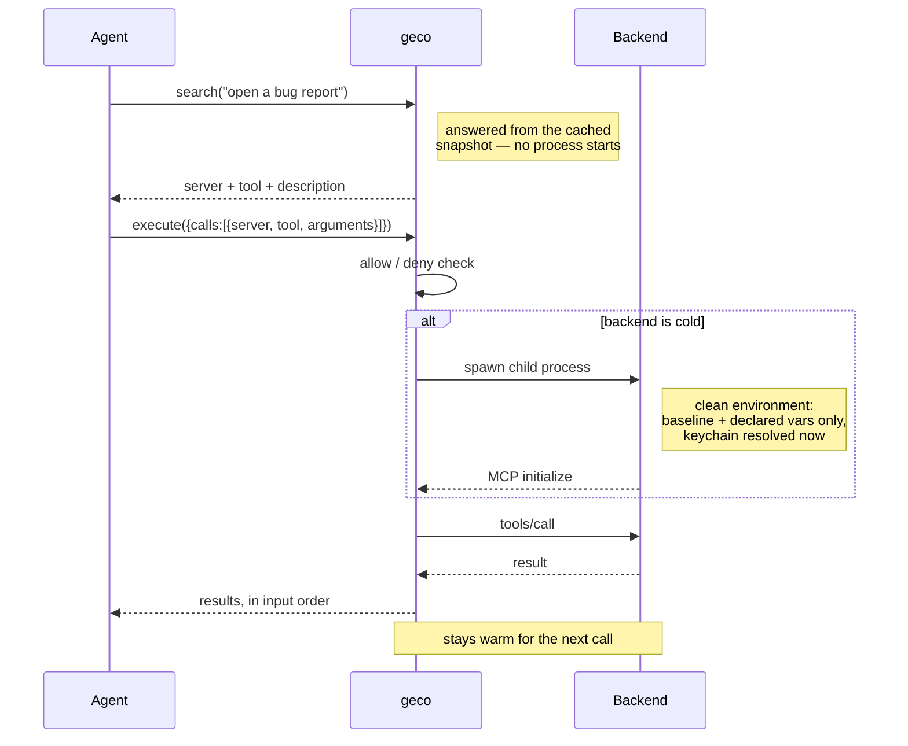

# geco

*the **ge**neric **co**nnector*

## Why it exists

[MCP](https://modelcontextprotocol.io) (Model Context Protocol) is how agents connect to external tools — GitHub, a browser, your filesystem. Each connected server hands the model its full tool catalogue: every tool name, description and JSON input schema, in the system prompt, on every request.

The more MCP tools you expose to your LLM, the more the context gets prefilled with ballast that most likely is not even used, reducing the space you have to work with.
The same is true for skills. Skills are great recipes to have but they also land as descriptive text in the context of your LLM — and again, more skills means less remaining context for the actual task.

So here comes this rusty reptile geco to tackle it. It sits between your IDE and the skills and MCP tools that you have, and gives your LLM the same 6 tools always, no matter how much you have in your tool shed.

**geco is an MCP and SKILL gateway** that keeps your servers' tool schemas **out of the model's context until the moment they're needed**. Put N servers behind it; the agent sees six small meta-tools instead of every schema on every request.

The cost is fixed: **~4.3 KB of context, whatever is behind the gate** — 10 servers or 100. That number is measured by a test, not asserted, so it can't quietly drift.

### And you stop restarting your agent

Add an MCP server to a normal setup and you restart the harness, because the client asks for the tool list once at connect and caches it. Same for a new skill. It is a small thing that happens constantly, and it breaks your train of thought every time.

**Behind geco, nothing downstream ever has to restart.** Drop a new skill into the library, drop one into the absorb inbox, or add a whole new MCP server to `geco.yaml` — the next `search` finds it, in the same session, with the agent none the wiser.

This is not a feature bolted on; it falls out of the design. Your client's tool list is the same six meta-tools before and after, so there is nothing for it to reload. The servers and skills live *behind* `search`, which reads the current snapshot every time it is called. geco watches the config and the skill directories, and listens for backends that announce their own tool changes (`notifications/tools/list_changed`), so the catalogue behind the gate keeps up on its own.

**Including geco's own tool list.** The six meta-tools are decided per request from the config as it currently stands, and geco advertises `tools/list_changed` and sends it when the set moves — so configuring your first skill library, or flipping `proxy.surface`, takes effect on a live session too.

Verified end to end in a single MCP session, never reconnected: a new skill in the library, a new skill via the inbox, a brand-new server's tools, a first skill library appearing, and `surface: lean` switching on and back off — all of it without restarting anything.

Built with Rust as single static binary, no runtime dependencies. macOS, Linux, and Windows. Design inspired by [lazy-mcp](https://github.com/voicetreelab/lazy-mcp) (MIT) — reimplemented from scratch on the official [rmcp](https://crates.io/crates/rmcp) SDK, with search, self-refreshing snapshots, allowlists, and status built in.

## How it works

The agent sees exactly six meta-tools:

| Meta-tool | Purpose |
|---|---|
| `list_mcp_servers` | Name, description, tool count, running state of each backend — plus `issues` when the gateway has a problem |
| `list_tools` | A server's tools (name + description); with `tool`: the full input schema |
| `list_skills` | Every skill in the library (name + one-line description) |
| `read_skill` | Load a skill's SKILL.md + file inventory (runs bundled scripts via your shell) |
| `search` | Find tools AND skills by keywords in one call; `include_schema=true` for inline schemas; `kind="tools"` or `"skills"` to filter |
| `execute` | Run 1–10 tool calls in one round-trip; cross-backend calls run in parallel; results in input order |

Six, and that is the whole always-on surface — 4,376 bytes of schema plus a short instruction, whatever hides behind it. Two things are deliberately *not* here: gateway health and manual refresh. Both are operator actions, and both live on the CLI — see [reporting problems](#reporting-problems) and [hot reload](#hot-reload).


Tool catalogues come from a **snapshot** cached on disk. The proxy refreshes it automatically at startup when your config changes (hash-based), or on demand — backends stay cold the rest of the time. A backend process starts only when `execute` first touches it, and is reused afterwards.

A full round trip, cold backend included:



Calls to *different* backends in one `execute` run in parallel; results always come back in the order you sent them.

## Install

Prebuilt binaries are published for macOS (arm64, x86_64), Linux (x86_64 static, aarch64) and Windows (x86_64) — **no Rust toolchain required**. The installers download the right one, verify its SHA-256, and fall back to a source build for any other platform.

### macOS / Linux

```bash
git clone https://github.com/berndsalomon83/geco.git && cd geco
bash install.sh
```

### Windows

```powershell
git clone https://github.com/berndsalomon83/geco.git; cd geco
.\install.ps1
```

Add `--from-source` (`-FromSource` on Windows) to build with cargo instead. See [INSTALL.md](INSTALL.md) for checksums, macOS Gatekeeper, and the private-repo caveat.

### Wire it into your agent

Move the MCP servers you want behind the proxy into `~/.config/geco/config.yaml` (copy-paste from your existing agent config — the `mcpServers` format is identical). Then register the **proxy** instead of the individual servers:

**OpenCode** (`~/.config/opencode/opencode.json`):
```jsonc
{
  "mcp": {
    "geco": { "type": "local", "command": ["geco", "serve"], "enabled": true }
  }
}
```

**Claude Desktop** (`claude_desktop_config.json`):
```json
{
  "mcpServers": {
    "geco": { "command": "/path/to/geco", "args": ["serve"] }
  }
}
```

Remove the individual server entries you moved behind geco — restart the agent and it sees only the 6 meta-tools. See [INSTALL.md](INSTALL.md) for the full guide.

## Quick start

```bash
bash install.sh          # downloads a prebuilt binary, or builds if none matches
```

Create `~/.config/geco/config.yaml` (see `geco.example.yaml`; JSON is equally accepted) — entries are copy-paste compatible with both Claude Desktop and OpenCode shapes:

```jsonc
{
  "mcpServers": {
    "github": {
      "command": "npx",
      "args": ["-y", "@modelcontextprotocol/server-github"],
      "env": { "GITHUB_PERSONAL_ACCESS_TOKEN": "${GITHUB_TOKEN}" },
      "description": "GitHub: issues, PRs, repos",
      "deny": ["delete_*"]
    },
    "filesystem": {
      "command": ["npx", "-y", "@modelcontextprotocol/server-filesystem", "${HOME}/Documents"],
      "description": "Files under ~/Documents"
    }
  }
}
```

## Skills on demand

Agent skills have the same context disease as tools: every skill's name and description ride in the system prompt of every session (measured live: 36 skills ≈ 2,300 tokens, used or not). Point the gateway at a skill library instead:

```yaml
skills:
  dirs: ["~/.config/opencode/skills-library"]
```

Three meta-tools appear: `list_skills` (the whole catalogue), `search` (with `kind="skills"` to find a playbook by intent) and `read_skill` (full SKILL.md + bundled file paths — the agent runs scripts via its shell exactly as a native skill would instruct). Migration: move skills out of the auto-loaded dir into the library; keep your few daily drivers native if you like:

```bash
mkdir -p ~/.config/opencode/skills-library
mv ~/.config/opencode/skills/* ~/.config/opencode/skills-library/
```

### Why your agent now searches before acting

A hidden library only pays off if the model reaches for it — and left to itself it doesn't. Measured against three local models on a task where a playbook clearly applied, the model consulted geco in **0–1 runs out of 12**. Not "sometimes missed": effectively never.

So when a skill library is configured, geco tells the model so in its MCP instructions — the count, that skills are invisible otherwise, that they are not callable tools, and to search first. That lifts it to **8–12 out of 12**.

Two things that did *not* work, in case you're tempted:

- **Listing skill names.** It costs context proportional to your library, which is the one thing geco exists to avoid — and it measured *worse*: two of three models replied `CALL code-reviewer`, treating a skill name as a tool name and producing invalid calls. The instruction says "NOT callable tools" specifically to block that.
- **Putting the hint in the `search` tool description** instead of the instructions. Same words, 0–3 out of 12. The decision to consult at all comes from the system framing, not from individual tool descriptions.

The cost is one sentence, fixed size regardless of library size, added only when you actually have skills. The trade-off: your agent will sometimes search on trivial turns too. A search is a cached-snapshot lookup with no process spawn, so over-triggering is much the cheaper error.

You can reinforce it in your global AGENTS.md: *Before specialized work, search (kind="skills") → read_skill and follow the playbook.*

### Which tools' skills work

Any of them. geco has no notion of opencode here — a skill is just a directory
containing a `SKILL.md` with YAML frontmatter, which is the Agent Skills
layout Claude Code, Claude Desktop and opencode all use. Point `dirs` at a
library and `absorb` at whatever directory your agent auto-loads from:

```yaml
skills:
  dirs: ["~/.config/geco/skills-library"]   # served on demand
  absorb:                                    # swept into the library at startup
    - "~/.claude/skills"                     # Claude Code
    - "~/.config/opencode/skills"            # opencode
```

Three things to know:

- **`absorb` MOVES directories**, which is the point — the auto-loaded dir
  stays empty so nothing costs always-on context. Never point it at a
  project-level skills dir (`.claude/skills/` inside a repo): that is
  version-controlled content and absorbing it would rewrite the working tree.
  Use `dirs` for those instead, which only reads.
- **Only `name`, `description` and `version` are read** from the frontmatter.
  Host-specific fields are ignored rather than honoured — the SKILL.md body
  reaches the model intact, but anything the host tool *enforced* from
  frontmatter (tool restrictions, for instance) is not reproduced by geco.
- **Bundled scripts are as portable as you wrote them.** `read_skill` hands
  back absolute paths and the agent runs them through its own shell, so a
  skill shipping `run.sh` needs a POSIX shell on Windows regardless of geco.

The scanner itself is platform-neutral: `~` expands via `HOME` or
`USERPROFILE`, and CRLF `SKILL.md` files parse identically to LF ones — both
covered by tests that run on Linux, macOS and Windows.

## Config reference

**Format:** YAML is the standard (`config.yaml`); JSON works identically for paste-compat with agent configs. A JSON Schema — generated from the binary's own structs, so it can't drift — powers editor validation and autocomplete: `geco schema > ~/.config/geco/geco.schema.json`, referenced from the YAML via the `# yaml-language-server: $schema=…` header (see the example file).

Per server: `command` (string **or** array), `args`, `env` (with `${VAR}` expansion), `pass_env` (hand this server a variable from geco's own environment), `description` (shown in `list_mcp_servers` — write a good one, it's what the agent decides by), `allow` / `deny` (glob patterns, deny wins; enforced at listing **and** execution), `enabled`, and `call_timeout_secs` / `startup_timeout_secs` to override the proxy defaults for one slow backend.

`geco stats` reports search effectiveness alongside call counts: how many searches ran, how many found nothing, how often a search hit was actually executed, how often a skill was surfaced and then read, and the recent queries that matched nothing — each of those is either a tool you don't have or a description that doesn't say what the tool is for.

### How search ranks

BM25F over tokenised names, server names and descriptions: identifiers split on separators and camelCase (`browser_takeScreenshot` → `browser`, `take`, `screenshot`), conservative plural stemming, a hit in the name weighted above one in the description, and IDF so a word appearing all over your corpus counts for little. A small synonym table covers the gap where a request and a tool use different words for the same thing — "bug"/"ticket" for issue, "save" for write, "folder" for directory.

One rule depends on word order: a verb leading a request is expanded where the same word later in the sentence is not. "open a bug report" means *create* one; "any open defects?" does not. That single distinction is worth 18 points of rank-1 accuracy on the synonym row below, and rank 1 is what counts — a model acts on the first result and rarely rephrases.

It is lexical, deliberately: no model, no index, no state. Ranking a few hundred tools costs microseconds and there is nothing to invalidate when the snapshot changes.

The limits are measured rather than assumed, against a 71-query corpus in the test suite:

| | recall@1 | recall@5 |
|---|---|---|
| queries sharing vocabulary with the tool | 87.5% | 100% |
| queries needing a synonym | 72.7% | 100% |
| held out from all tuning | 65.0% | 80.0% |

That third row is the one to believe, and the only one worth trusting about *your* tools. Twenty queries are held out — written after the synonym table, never consulted while building it, and twelve of them written specifically to break the next proposed change rather than to confirm it. The first two rows are measured partly on the queries the table was derived from, which always flatters.

The guard earns its keep in both directions. It **rejected** a symmetric create/open synonym that raised the group it came from while lowering the group it didn't, and it **cleared** a `know` → `recall` mapping by leaving three deliberately planted "know"-means-something-else queries ranking correctly.

If a tool you know exists isn't surfacing, the fix is its `description`: that is the text search reads, and the text the model reads when deciding.

Measured against 5,216 tools from ~150 real MCP servers, the measured floor on *pure-intent* queries — where a user describes a goal in words the tool never uses — is about **13% rank-1**. That is the lexical-vs-semantic wall, and no tuning or synonym crosses it. The full research log, including every change that was tried and **rejected** so nobody re-walks those roads, is in [docs/search-ranking.md](docs/search-ranking.md).

### A leaner surface

The six meta-tools cost ~4.1 KB of always-on context. Three of them — `list_mcp_servers`, `list_tools`, `list_skills` — are **~1 KB of that, a quarter**, and everything they do is reachable another way:

```yaml
proxy:
  surface: lean     # search, execute, read_skill — and nothing else
```

| what you lose | what replaces it |
|---|---|
| `list_mcp_servers` | `search("*")` — one entry per server, with a tool count and a five-name preview |
| `list_skills` | `search("*", kind="skills")` |
| `list_tools(server, tool)` | `search(include_schema=true)`, which returns schemas inline |
| the `issues` health key | rides on **every** `search` response that needs it |

A miss volunteers the catalogue by itself — `nothing matched 'deploy a container' — try fewer or more general keywords. Available: github (42 tools), filesystem (11). Search "*" for the full catalogue.` That costs zero always-on bytes, arrives exactly when the question comes up, and needs the model to know no tricks.

`search("*")` returns **servers**, not every skill: a broad question shouldn't be answered with a wall of text nothing asked for. Skills are *counted* in the hint instead, which is a few tokens rather than hundreds and still tells the model they exist and how to list them.

**One thing genuinely goes:** enumerating a single server's whole tool list. `search("*")` previews five names each; `geco inspect` has the rest for a human.

It is **not the default**, deliberately. The case for it is a prediction about how models behave, and in this project roughly 30% of those survive measurement. `geco stats` now counts calls per meta-tool — run your real workload and look before deciding:

```
meta-tool calls (the always-on surface earning its bytes):
  search                  2
  execute                 1
  list_mcp_servers        1
```

### Crossing the wall: the LLM picker

**Off by default.** No lexical trick crosses that 13% wall, because the problem isn't spelling — it's meaning. A model crosses it in one round-trip: show it the tools, ask which one the user actually meant, hoist that answer to rank 1.

The measurements above are all against **5,216 tools from 131 servers, which nobody runs**. On a catalogue the size of a real config — eight servers, ~324 tools — measured over the same 210 vocabulary-banned queries:

| what the model is shown | recall ceiling | **rank-1** | latency |
|---|---|---|---|
| nothing (lexical only) | — | 24.8% | µs |
| BM25F's top 50 | 82% | 74.6% | 2.2 s |
| **the whole catalogue** | **100%** | **94.8%** | **0.9 s** |

Sending everything is both **more accurate and faster**, which sounds wrong twice over. Both have the same cause.

*Accuracy:* precision did not fall under seven times the distractors — 90.5% against the shortlist's 90.7%, measured like for like — because **BM25F doesn't select random distractors, it selects the most confusable ones.** Every shortlisted candidate was chosen for sharing vocabulary with the query, so a shortlist is precisely the set of plausible wrong answers, while the tools it drops are mostly obvious non-answers a model rejects at a glance. The last 4 points came from something duller: putting the catalogue *before* the question rather than after it, which was done for caching and turned out to be worth 90.5% → 94.8% on its own.

*Speed:* an unchanging catalogue is a **cacheable prompt prefix**. Measured at 15,243 prompt tokens: 96.6% served from cache, 13× faster than the same prompt reordered per call. A BM25F shortlist can never cache — it's recomputed per query by definition.

So geco hands the model your whole catalogue whenever it fits in `whole_catalogue_tokens` (default ~24k, about 500 tools), and falls back to `candidates` best lexical hits above that. Nothing to tune for a normal config.

**Skills go through the same picker**, in the same call, from one combined list — the model answers "what is the best capability here", of either kind, and whichever surface it didn't choose keeps its lexical order. Two separate picks would be worse, not better: the prompt has no "none of these" escape, so asking "which skill fits?" about a pure tool request gets an answer anyway, and that noise would land at rank 1. (The measurements above are for tools; the skill path is the same code and is tested end to end, but there's no labelled skill corpus yet, so it's unmeasured.)

geco ships **no HTTP client** to do this. Adding one would drag a TLS stack into a binary whose whole pitch is no runtime dependencies, to do a job `curl` in a three-line script already does. You bring the transport:

| `mode` | What it does |
|---|---|
| `off` | Lexical ranking only. The default. |
| `sampling` | Ask your own client for its model via MCP `sampling/createMessage`. Zero config and no second model to pay for — but only works if your client implements sampling, which today most do not. |
| `command` | Run any command and read its stdout: `opencode run …`, `claude -p`, `codex exec`, or a two-line wrapper around an OpenAI-compatible endpoint (LM Studio, Ollama, vLLM, a hosted API). |
| `auto` | Sampling if the client advertises it, else `command` if one is configured, else off. |

```yaml
proxy:
  picker:
    mode: command
    command: ["opencode", "run", "--agent", "minimal", "{prompt}"]
```

`{prompt}` anywhere in the arguments is substituted; with no placeholder the prompt is appended as the final argument. The child is spawned with `GECO_NO_PICKER=1` so a nested geco can refuse to recurse.

**Every failure degrades to the lexical order** — unsupported, unreachable, timed out, answered in prose, named a tool that doesn't exist. Enabling a picker can cost you latency; it cannot break search or return something that isn't yours. One asymmetry is deliberate: a client that *advertises* sampling and then refuses to serve it is asked exactly once per session, because otherwise every search would pay a doomed round-trip — and, on clients that prompt for approval, show you a dialog — for a lexical answer geco was always going to return.

This is geco asking *your client* for a model, and it is the only thing that does: a backend behind the gateway still cannot reach your model (see [What geco proxies](#what-geco-proxies-and-what-it-doesnt) below).

Cost is real and worth sizing before you enable it — but less than it looks, because the catalogue caches. A 324-tool catalogue is ~16k tokens, of which ~97% is served from the prompt cache after the first search; measured at 0.9s per search against a small model on a home GPU box. Above `whole_catalogue_tokens` the shortlist path is used and nothing caches, so that's the expensive mode, not the cheap one.

| Key | Default | What it does |
|---|---|---|
| `picker.mode` | `off` | One of the four above. |
| `picker.command` | `[]` | Argv for `command` mode. |
| `picker.whole_catalogue_tokens` | 24000 | Show the model every tool when the catalogue fits in roughly this many tokens (~500 tools). `0` disables, always using `candidates`. |
| `picker.candidates` | 50 | Fallback shortlist size, for catalogues over that budget. |
| `picker.timeout_secs` | 20 | Give up and return the lexical order. |

**Give the picker a small, fast, non-reasoning model.** Picking a tool is classification, and a reasoning model answers it as though it were reasoning: measured on one endpoint, `qwen4b` spent its whole 512-token budget in a hidden reasoning channel and returned **empty content on 7 of 8 searches**, while `qwen-coder` answered the identical prompt in **20 tokens**. Same box, same endpoint, same prompt — the fix was the model name, not a setting.

That is the whole recommendation, because there is no geco knob for this and there cannot be one. geco has no model: under `sampling` your client picks it, and under `command` it is whatever your CLI or wrapper script runs. Where thinking is decided depends on that stack, and it is not always reachable from the request — on the endpoint above, neither `/no_think` in the prompt nor `enable_thinking: false` on the call changed anything, because the chat template had the last word. Swapping the model is one line; chasing the serving config is not.

Getting it wrong costs latency, not correctness. Every failure degrades to the lexical order, which is what you get with the picker off anyway — so the real hazard is paying a round-trip per search for nothing, silently. geco watches for the signature (an empty reply at the token ceiling, or three consecutive searches with no usable answer) and logs what to do, because otherwise it looks exactly like a picker whose model agrees with lexical ranking every time.

For scale: a deliberating model measured **8% rank-1 against the 13.3% lexical baseline** — worse than not asking at all. That is why the reply budget is sized for the answer rather than the thinking, and why geco does not simply raise it.

### What geco proxies (and what it doesn't)

geco proxies **tools**. Backend *resources* and *prompts* are not exposed
through the gateway, and because geco terminates the client side of each
backend session, a backend cannot use sampling or elicitation through it. If
a server's value is mostly resources or prompts, wire it up directly rather
than behind geco.

Tool lists stay current on their own: geco listens for
`notifications/tools/list_changed` and re-scans that one backend when it
fires, so a server that adds or removes tools at runtime is picked up without
a manual refresh. Servers that don't send the notification are still
snapshot-based — refresh them manually or let a config change do it.

### Backend environment isolation

Since 0.7, a backend does **not** inherit geco's environment. Each child starts clean and receives only an OS/runtime baseline — `PATH`, `HOME`/`USERPROFILE`, temp dirs, locale, TLS trust (`SSL_CERT_FILE`, `NODE_EXTRA_CA_CERTS`, …) and proxy settings (`HTTP_PROXY` and friends) — plus whatever its own `env` and `pass_env` declare.

The point: a `GITHUB_TOKEN` exported in your shell for one server is no longer handed to every other server you run. Aggregating many backends behind one gateway means one compromised or careless server otherwise sees every secret in the environment.

If a server needs an ambient variable, name it: `pass_env: ["GITHUB_TOKEN"]`. For non-secret tool configuration wanted by *every* backend, use `proxy.env_passthrough: ["NODE_*"]` (glob patterns). To restore the old behaviour wholesale, `proxy.inherit_env: true` — but then any server can read anything.

### The `proxy` block

Gateway-wide settings, all optional:

| Key | Default | What it does |
|---|---|---|
| `call_timeout_secs` | 120 | Seconds allowed for a proxied tool call. Override per server for one slow backend. |
| `startup_timeout_secs` | 30 | Seconds allowed for a backend to spawn and initialize. Raise it if a first `npx` run downloads. |
| `refresh_on_start` | true | Re-scan backends at startup when the config hash changed. |
| `health_check_secs` | 30 | How often to check warm backends are still alive. `0` disables. |
| `refresh_concurrency` | 8 | How many backends may be probed at once during a refresh. `0` = unlimited. Caps the process storm when many servers are configured. |
| `inherit_env` | false | Give backends geco's whole environment (pre-0.7 behaviour). See above. |
| `env_passthrough` | `[]` | Extra non-secret variables every backend receives, as globs. |
| `surface` | `full` | `lean` serves only `search`, `execute` and `read_skill` — see [a leaner surface](#a-leaner-surface). |
| `search_synonyms` | `[]` | Extra interchangeable-word groups for ranking, e.g. `[["k8s","kubernetes"]]`. Applied on top of the built-in table; picked up on hot reload. |
| `picker` | off | Optional LLM tool picker — see [Crossing the wall](#crossing-the-wall-the-llm-picker). |

### Secrets

Don't put tokens in the config or your shell rc. `${keychain:SERVICE}` resolves from the OS keychain **at backend spawn time** — the secret exists only in that child process's environment:

```jsonc
"env": { "GITHUB_PERSONAL_ACCESS_TOKEN": "${keychain:github_token}" }
```

Store it once:
- **macOS:** `security add-generic-password -a "$USER" -s github_token -w '<token>'`
- **Linux:** `secret-tool store --label='geco' service github_token` (libsecret / `secret-tool`)
- **Windows:** `cmdkey /generic:github_token /user:geco /pass:<token>` (Credential Manager via PowerShell CredReadW)

A missing keychain item fails the spawn loudly — plain `${VAR}` env references still expand to "" like shell. There is deliberately no `${cmd:...}`: arbitrary command execution from a config file is an injection surface.

## CLI

```bash
geco serve [--refresh|--no-refresh]   # run the proxy (default command)
geco refresh                          # rebuild the snapshot; nudges a running proxy to reload
geco inspect                          # show the cached snapshot
geco health                           # what's broken right now (exit 1 on errors)
geco stats                            # show runtime metrics (calls, errors, latency)
geco validate                         # check config for common mistakes
geco schema                           # print the config JSON Schema (YAML + JSON)
```

`RUST_LOG=debug` for verbose logging (always stderr — stdout is the protocol).

## Hot reload

The gateway watches its config file and auto-refreshes when it changes — add a server, edit a denylist, update a description, save, and the agent sees it within seconds. No restart, no manual step. Removed backends are shut down; new ones are snapshotted and available immediately.

The same goes for skills: the directories in `skills.dirs` and `skills.absorb` are watched too, so a skill written or dropped in while geco is running is swept into the library and searchable without anything being restarted.

**The reason almost none of this reaches your client is the whole design.** Its tool list is the same meta-tools throughout, so there is nothing to invalidate and nothing to reconnect. Compare the usual case: a client asks for `tools/list` once at connect, so a new MCP server means restarting the harness.

For the one case where geco's *own* list does move — your first skill library appearing, or `proxy.surface` changing — the advertised set is computed per request from the current config, and geco advertises `tools/list_changed` and sends it. A client that listens re-fetches; one that doesn't is no worse off than before, since an unadvertised meta-tool stays callable rather than erroring. No restart either way.

The watcher triggers on **mtime**, not content, which is what makes `geco refresh` work against a live proxy: it rewrites the snapshot file *and* touches the config, so a running instance rebuilds instead of quietly serving its in-memory copy. (Content is untouched — only the timestamp moves.)

That covers the one case nothing else does: a backend **upgraded in place**, where the config never changed and the server sends no `tools/list_changed`, so no automatic path notices. There is deliberately no `refresh_tools` meta-tool for the agent — installing software is something you do, and the agent shouldn't carry 480 bytes of schema in every session for it.

## Self-healing backends

Warm backends that crash silently (child process exits) are detected two ways, and it takes both. Any `execute` against a dead backend notices immediately and reconnects fresh — that path is reactive, so the triggering call still fails once. To close that window, a background check every 30 seconds (configurable via `health_check_secs`, `0` to disable) **actively probes** each warm backend with a `list_tools` round-trip and resets the ones that don't answer, so an idle backend that died between calls is usually cleared before the next `execute` reaches it.

The probe is necessary rather than incidental: a dead child leaves the connection *looking* open — the client only notices the broken pipe when it next sends something — so a passive "is the socket closed?" check reports an idle-dead backend as healthy indefinitely. `list_tools` is used rather than the spec's `ping` because every backend geco can proxy answers it (it is how the snapshot is built), whereas a live server that happens not to implement `ping` would be reset on every sweep.

## Reporting problems

The gateway is headless, so a dead backend or a partial refresh would otherwise live only in a stderr log. Instead it writes its current problem set to `<data-dir>/health.json` (level-triggered: empty = healthy, tagged with the MCP client name). Three ways to see it:

- **`geco health`** — the full report, for you.
- **The opencode toast plugin** (`opencode-plugin/geco-tui.ts`, installed automatically when opencode is present) — polls `health.json` and raises an in-app toast when a problem appears or clears. A persistent problem toasts once, not every tick.
- **`list_mcp_servers`**, for the agent — per-server `status` and `last_refresh`, plus an `issues` array when something is wrong.

There is deliberately no `health` meta-tool. It would cost every session's context to answer a question that only arises once something is already broken, and by then the answer has already been delivered twice: `execute` returns a typed `error.code` (`backend_error`, `timeout`, `not_allowed`) with the reason at the moment of failure, and `list_mcp_servers` carries the rest. Diagnostics belong in the payload, where they cost nothing until needed — not in the schema, where they cost something always.

## Troubleshooting

Start with `geco health` (what's broken right now), then `geco validate` (config mistakes), `geco inspect` (what the snapshot actually holds) and `geco stats` (what the agent has been doing).

**A server worked before 0.7 and now fails with an auth or config error.**
The most likely cause, and the nastiest to spot, because it fails *late*: since 0.7 backends no longer inherit geco's environment, so a server that quietly relied on a variable exported in your shell now starts without it. There is no startup error — it fails on first `execute`, with whatever opaque message the backend produces. Name the variable: `pass_env: ["THE_VAR"]`. To confirm that's the cause, set `proxy.inherit_env: true` temporarily; if it works again, that was it.

**`backend 'x': command 'npx' not found. Is it installed and on the PATH geco was started with?`**
The command isn't on geco's `PATH`, and geco's PATH is not necessarily your shell's. Two common causes: the agent launched geco from a GUI (which often has a much shorter PATH than your terminal), or the tool was installed by a version manager — `nvm`, `fnm`, `volta` — that only edits the PATH in your shell's rc file. Fix by launching the agent from a shell where the command works, or use an absolute path in `command`. `geco validate` warns about commands it can't resolve before you hit this at runtime.

**`keychain item 'x' not found`.**
The item doesn't exist under that exact service name, or the OS keychain is locked. Check with `security find-generic-password -s x -w` (macOS), `secret-tool lookup service x` (Linux), `cmdkey /list:x` (Windows). A missing item is deliberately fatal — secrets fail loudly rather than expanding to an empty string.

**The agent can't find a tool you know is there.**
Check `geco inspect` first — if the tool isn't in the snapshot, it's a refresh or an `allow`/`deny` problem, not a search problem. If it *is* there, the search wording is the issue: `geco stats` lists recent queries that matched nothing. Search is lexical with a small synonym table ([how search ranks](#how-search-ranks)) — a query sharing no vocabulary and no synonym with the tool's name or description won't find it. Improve the server's `description`, which is what the model actually reads.

**Tools changed on a backend but geco still shows the old set.**
geco follows `notifications/tools/list_changed`, but not every server sends it, and a backend upgraded in place (config unchanged) has nothing to notify about. Force a rebuild with `geco refresh` — it rewrites the snapshot AND bumps the config mtime, which is what makes a *running* proxy reload rather than keep serving its in-memory copy.

**macOS: "cannot be opened because the developer cannot be verified".**
The released binaries are unsigned. `xattr -d com.apple.quarantine "$(command -v geco)"`.

**Nothing is happening / no output.**
`RUST_LOG=debug geco serve`. All logging goes to stderr by design — stdout carries the MCP protocol, so anything printed there would corrupt the session.

## Which servers belong behind the proxy?

Servers you use *sometimes*. A server whose tools you want the model to reach for proactively on every task (e.g. a memory store like [icm-slim](https://github.com/rtk-ai/icm)) can stay directly connected — visibility is the point there. Everything else is a candidate.

## Working on geco

`main` is protected: force-pushes and deletion are blocked, and the CI checks
must pass before a merge. Repository admins keep a bypass — deliberately, so
that a broken pipeline can still be repaired.

```bash
git config core.hooksPath .githooks   # once per clone: fmt/clippy/tests before push

bash scripts/lint.sh                  # the checks cargo doesn't do

git switch -c fix/thing
# ...
git push -u origin HEAD
gh pr create --fill
gh pr merge --auto --squash           # merges itself once CI is green
```

The pre-push hook is a convenience, not the gate. CI is the gate: it runs on
Linux, macOS and Windows and enforces things a local run can't — the e2e suite
against a guaranteed Python, the macOS keychain round-trip, the MSRV floor,
supply-chain and secret scanning. `git push --no-verify` skips the hook.

On Windows the hook looks for cargo on `PATH`, then in `~/.cargo/bin`, then
**through WSL** — a toolchain installed inside WSL is invisible to Git Bash,
so the hook used to print "skipping" on every push and check nothing at all.

`scripts/lint.sh` mirrors CI's `lint` job: shellcheck, actionlint, typos,
gitleaks, PSScriptAnalyzer. Missing tools are skipped rather than fatal — but
it always prints which ones it **didn't** run, because a linter that silently
checks nothing is worse than none at all. CI runs the full set regardless.

CI also publishes a per-file **coverage** table to each run's summary, sorted
worst-first. It gates nothing: a percentage target drives tests toward
whatever is cheapest to cover, not whatever is riskiest. It exists so that
"nothing tests this file at all" is visible — which is how `backend.rs` sat
at 461 lines with no direct tests until its first one found a panic.

## License

MIT. Design derived from lazy-mcp (© 2025 tbxark, MIT); this implementation © 2026 Bernd Salomon.
